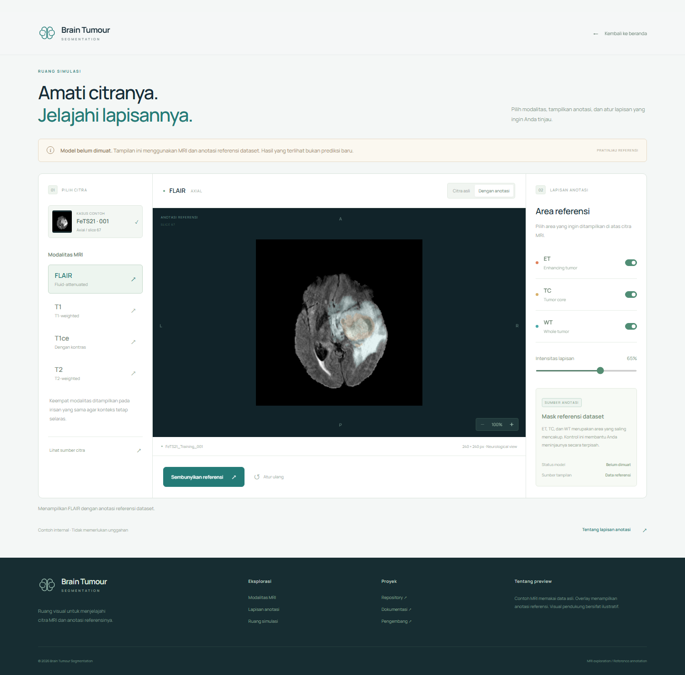
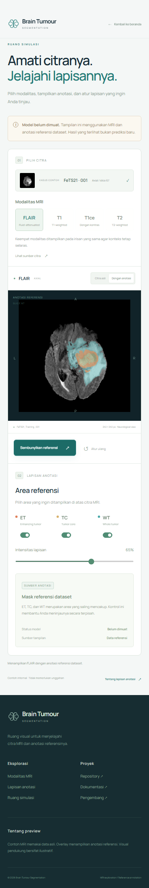

# Brain Tumour Segmentation

Research on MRI volume segmentation with 3D U-Net and U-Net++, using a MedicalNet ResNet18 encoder. The repository includes training and inference notebooks, six experiment reports, a complete sample MRI case, saved visualizations, and assets prepared for a future project website.

## Repository layout

```text
BrainTumourSegmentation/
├── notebooks/                   # U-Net, U-Net++, and prediction notebooks
├── data/
│   ├── samples/                 # Checked-in FeTS21 MRI case and reference mask
│   └── raw/                     # Local training dataset, ignored by Git
├── models/
│   ├── pretrained/              # MedicalNet checkpoint pointer via Git LFS
│   └── checkpoints/             # Local experiment checkpoints, ignored by Git
├── reports/
│   ├── experiments/             # Six original CSV reports
│   └── figures/                 # 44 original notebook PNG outputs + provenance
├── assets/
│   ├── images/editorial/        # Six generated supporting visuals
│   ├── images/dataset/          # 13 MRI/reference assets + source manifest
│   └── preview.html             # Local asset contact sheet
├── design/                      # Interactive landing + simulation design preview
├── scripts/                     # Shared paths and CPU-only MRI asset exporter
├── docs/                        # Research setup and asset placement/prompt guide
├── .env.example                 # Optional paths and Kaggle configuration
└── requirements-assets.txt      # Lightweight image-export dependencies
```

The folder migration preserves the original MRI files, CSV report contents, and pretrained LFS pointer. Paths inside the notebooks now resolve from the repository root. Notebook outputs have been cleared after their 44 PNG visualizations were saved in [reports/figures](reports/figures); their source cells and hashes are recorded in the [figure manifest](reports/figures/manifest.json).

## Website assets

Six editorial visuals cover the brain sculpture, MRI room, radiologist, collaborative image review, head coil, and imaging desk. Three have genuine transparent backgrounds. People, facilities, and equipment in these generated visuals are illustrative.

The 13 dataset assets are exported directly from the checked-in NIfTI volumes and reference mask: four MRI modalities, axial/coronal/sagittal views, reference overlays, and transparent ET/TC/WT layers. These overlays are dataset annotations, not new model predictions. The [dataset manifest](assets/images/dataset/manifest.json) records source hashes, orientation, selected slices, intensity windows, and output hashes.

See the [asset preview](assets/preview.html), [placement guide](docs/assets/README.md), [editorial manifest](docs/assets/editorial-manifest.json), and [generation prompts](docs/assets/prompts/). Open `assets/preview.html` locally to browse the assets. The page designs below provide working browser interactions; a model/API integration is not implemented yet.

## Interactive page designs

The [design preview](design/) has a landing page with text on the left and an actual slowly rotating 3D brain on the right, plus a separate MRI/reference simulation. The workspace supports modality selection, ET/TC/WT layers, opacity, zoom, and reset. A notice states that the model is not loaded; reference annotations are not new predictions.

```bash
cd design
npm ci
npm run dev
```

Open **http://localhost:3002/** for the landing and **http://localhost:3002/simulasi.html** for the simulation. `npm run build` produces a static build of both pages. See the [layout and motion specification](docs/design.md).



<details>
<summary>Mobile simulation design</summary>



</details>

## Export MRI assets without loading a model

From the repository root on Windows:

```powershell
python -m venv .venv
.\.venv\Scripts\python.exe -m pip install -r requirements-assets.txt
.\.venv\Scripts\python.exe scripts/export_mri_assets.py
```

On macOS/Linux, use `.venv/bin/python`. This exporter uses NiBabel, NumPy, and Pillow on the CPU. It does not import PyTorch/MONAI, download weights, or initialize a model. An optional `--png-copy-dir PATH` writes additional PNG originals and WebP copies to a chosen folder.

## Research notebooks

| Notebook                                             | Purpose                                                        |
| ---------------------------------------------------- | -------------------------------------------------------------- |
| [intern_unet.ipynb](notebooks/intern_unet.ipynb)     | 3D U-Net baseline, warmup/freeze, and warmup/LR experiments    |
| [intern_unetpp.ipynb](notebooks/intern_unetpp.ipynb) | 3D U-Net++ variants and optional Kaggle download cell          |
| [prediksi.ipynb](notebooks/prediksi.ipynb)           | Six checkpoint-specific prediction and visualization workflows |

Start Jupyter from the repository root or `notebooks/`, then run the repository setup cell first. Full research execution requires the dataset, compatible ML dependencies, and the relevant checkpoints. See [research setup](docs/research.md), [sample data](data/README.md), [model locations](models/README.md), and [report guide](reports/README.md).

To clone without downloading the pretrained checkpoint binary:

```powershell
$env:GIT_LFS_SKIP_SMUDGE = '1'
git clone https://github.com/Ditt-A/BrainTumourSegmentation.git
```

Notebook training and prediction cells remain explicit research operations; organizing the repository and preparing these assets did not run them.

## Original project resources

- [Trained model weights](https://huggingface.co/ditt-a/3D_UnetPlusPlus_Brain_Tumour_Segmentation)
- [BraTS20 training and validation dataset](https://www.kaggle.com/datasets/awsaf49/brats20-dataset-training-validation)
- [Project documentation in Indonesian](https://docs.google.com/document/d/1iAkgFkUGjsJR2xT7ZMA4Fa-2kk25uirJvzk7JTM10Tc/edit?usp=sharing)
